# UserHub – Multi-Page React App with Routing

**Entri Elevate – Full Stack Development · Module: React JS · Assignment 11**

UserHub is a small user directory built with **React** and **React Router (`react-router-dom`)**. It has four pages
(Home, About, Users and User Detail), a persistent navigation bar that highlights the current page, a
parameterised route (`/users/:id`) and a responsive layout written in plain CSS.

> **GitHub repository:** _add the link here after pushing_

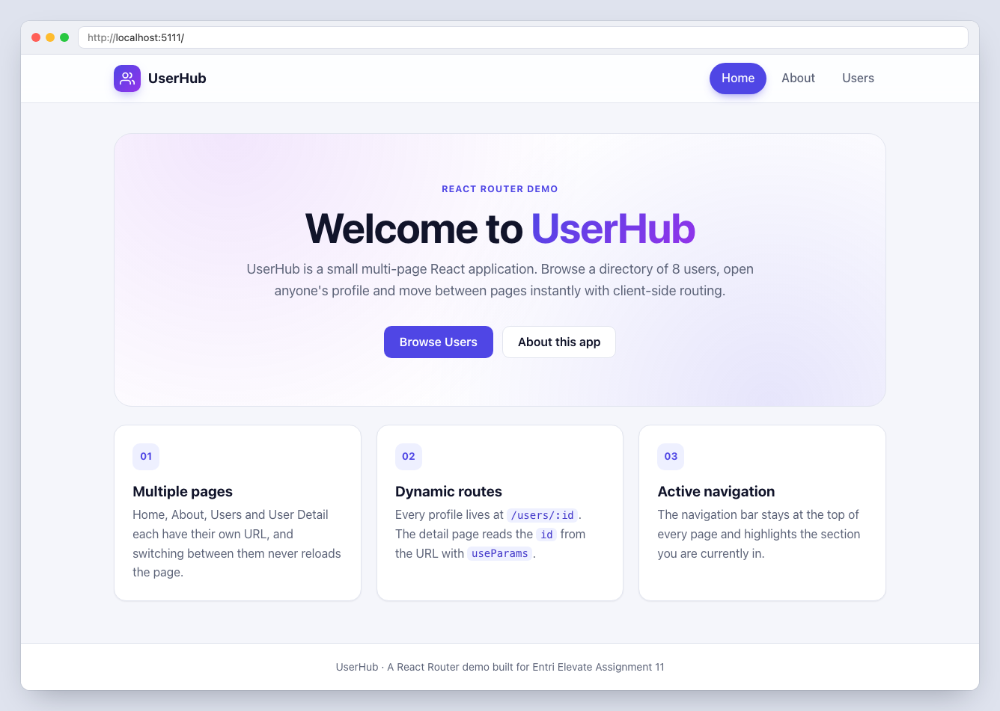

---

## Features

- **Four pages, four routes:** `/`, `/about`, `/users` and `/users/:id`, plus a catch-all **404** page.
- **Persistent navigation bar** rendered once in a shared layout route, so it stays at the top of every page.
- **Active route highlighting** with `NavLink`. *Home* only matches `/` exactly. *Users* stays highlighted on
  `/users/:id` too.
- **Users list** built from a mock array of user objects. Every user card links to that user's detail page.
- **User detail page** reads the `id` from the URL with `useParams()` and shows the user's name, email, phone,
  role, company and location. A **Go Back** button returns to the Users page.
- **Graceful errors:** an unknown user id (for example `/users/99` or `/users/abc`) shows a *User not found*
  message with a Go Back button. Any other unknown URL shows the 404 page with links back to Home and Users.
- **Client-side navigation:** pages never reload, the browser back/forward buttons work, every URL can be
  bookmarked or opened directly, and each page sets its own browser-tab title.
- **Responsive design:** works on phones (320px and up), tablets and desktops. Plain CSS with Flexbox, Grid and
  media queries; no UI framework.
- **Functional components only.** Components and pages live in separate folders.

## Tech stack

| Tool                         | Purpose                                                  |
| ---------------------------- | -------------------------------------------------------- |
| React 19                     | UI with functional components and hooks                  |
| React Router 7 (`react-router-dom`) | Routing: `createBrowserRouter`, `NavLink`, `useParams`, `useNavigate` |
| Vite 8                       | Dev server and production build                          |
| Plain CSS                    | Styling (custom properties, Flexbox, Grid, media queries) |
| ESLint                       | Linting (React Hooks and React Refresh rules)            |

## Routes

| Path          | Page        | Component                 | Description                                         |
| ------------- | ----------- | ------------------------- | --------------------------------------------------- |
| `/`           | Home        | `pages/Home.jsx`          | Welcome message, app info, buttons to About and Users |
| `/about`      | About       | `pages/About.jsx`         | What the app does and why, with a link back to Home |
| `/users`      | Users       | `pages/Users.jsx`         | List of users; each one links to its detail page    |
| `/users/:id`  | User Detail | `pages/UserDetail.jsx`    | One user's details, read from the `id` URL parameter |
| `*`           | Not Found   | `pages/NotFound.jsx`      | 404 page for any other URL                          |

The route table is in [`src/App.jsx`](src/App.jsx):

```jsx
const router = createBrowserRouter([
  {
    path: '/',
    element: <Layout />,            // Navbar + <Outlet /> + footer
    children: [
      { index: true, element: <Home /> },             // /
      { path: 'about', element: <About /> },          // /about
      { path: 'users', element: <Users /> },          // /users
      { path: 'users/:id', element: <UserDetail /> }, // /users/:id
      { path: '*', element: <NotFound /> },           // any other URL -> 404 page
    ],
  },
]);
```

## Folder structure

```
react-routing-app/
├── public/
│   └── favicon.svg
├── screenshots/              # Screenshots used in this README
├── src/
│   ├── components/           # Reusable building blocks
│   │   ├── Avatar.jsx        # Initials badge for a user
│   │   ├── EmptyState.jsx    # Shared "not found" card
│   │   ├── Layout.jsx        # Navbar + <Outlet /> + footer (layout route)
│   │   ├── Navbar.jsx        # Persistent navigation with active links
│   │   └── UserCard.jsx      # A user in the list, linking to /users/:id
│   ├── data/
│   │   └── users.js          # Mock users array + getUserById helper
│   ├── pages/                # One component per route
│   │   ├── Home.jsx
│   │   ├── About.jsx
│   │   ├── Users.jsx
│   │   ├── UserDetail.jsx
│   │   └── NotFound.jsx
│   ├── App.jsx               # Route table (createBrowserRouter + RouterProvider)
│   ├── index.css             # Global styles and responsive rules
│   └── main.jsx              # Entry point
├── eslint.config.js
├── index.html
├── package.json
└── vite.config.js
```

## How it works

- **`App.jsx`** creates the router. Every page is a child of the `Layout` route, so the navbar is rendered once
  and only the page inside `<Outlet />` changes when you navigate.
- **`Navbar.jsx`** uses `NavLink`. Its `className` callback adds an `active` class (and React Router adds
  `aria-current="page"`) to the link for the current route. The Home link has `end` so it doesn't stay active on
  every page.
- **`UserDetail.jsx`** calls `useParams()` to get `id`, looks the user up with `getUserById(id)` and uses
  `useNavigate()` for the **Go Back** button. The button always goes to `/users`, even when the profile was opened
  from a bookmark.
- **`Layout.jsx`** also renders `<ScrollRestoration />`: a new page opens at the top, and going back restores your
  previous scroll position.
- **`users.js`** holds the mock data. The first two users match the assignment brief
  (`{ id, name, email }`). More users were added, with extra fields for the detail page.

## Getting started

**Requirements:** Node.js 20.19+, 22.13+ or 24+ and npm.

```bash
# 1. Install dependencies
npm install

# 2. Start the dev server, then open http://localhost:5173
npm run dev
```

### Available scripts

| Command           | What it does                                  |
| ----------------- | --------------------------------------------- |
| `npm run dev`     | Start the Vite dev server with hot reload     |
| `npm run build`   | Build an optimised production bundle in `dist/` |
| `npm run preview` | Serve the production build locally            |
| `npm run lint`    | Run ESLint (passes with no errors or warnings) |

> **Deploying:** this is a single-page app using browser history URLs, so the host must serve `index.html` for
> every path. Otherwise opening `/users/3` directly returns a server 404. On Netlify, add a `public/_redirects`
> file containing `/* /index.html 200`. On Vercel, add a rewrite of `/(.*)` to `/index.html`. Vite's own
> `dev` and `preview` servers already handle this.

## Screenshots

### Home (`/`)


### About (`/about`)
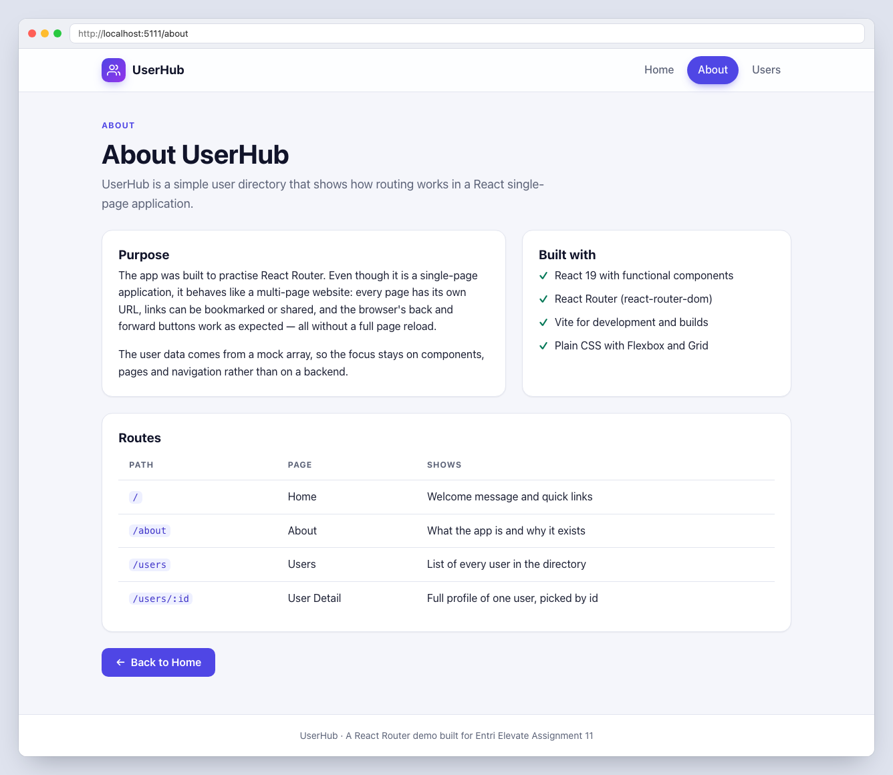

### Users list (`/users`)
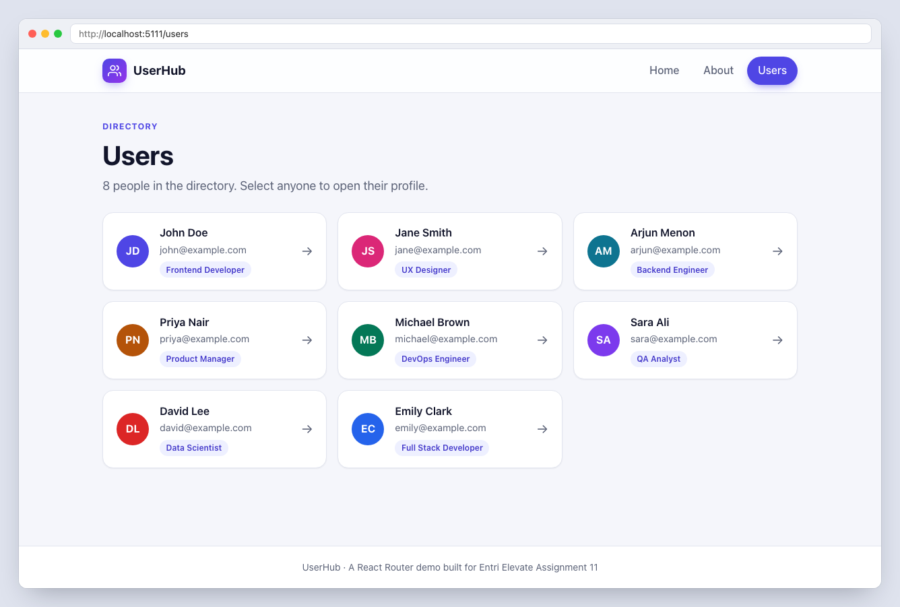

Hovering a user card lifts it and highlights the arrow:

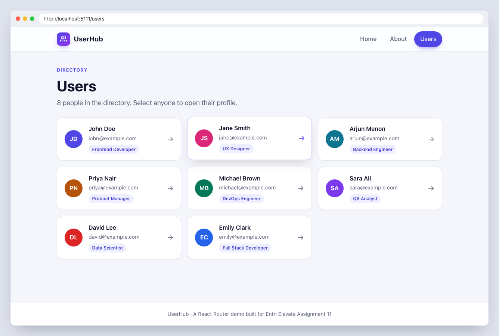

### User detail (`/users/1`)
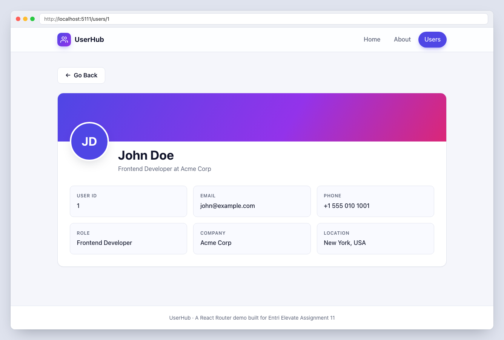

### User not found (`/users/99`)
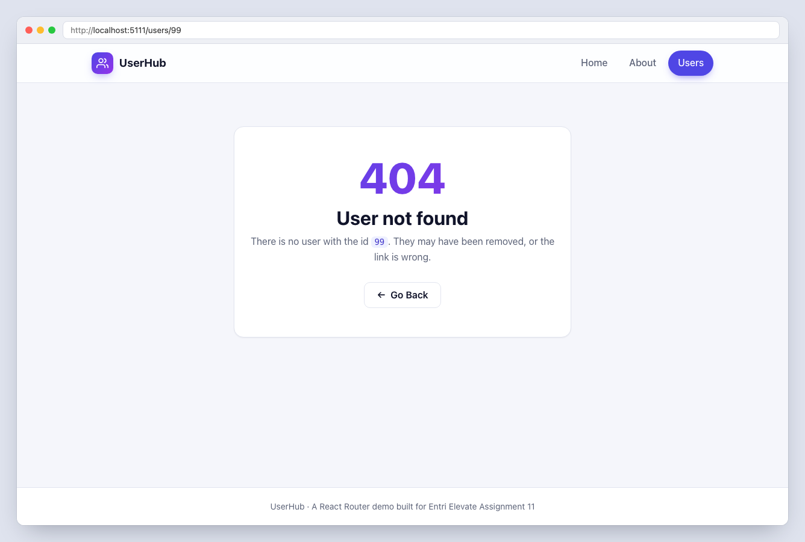

### 404 page (any unknown URL)
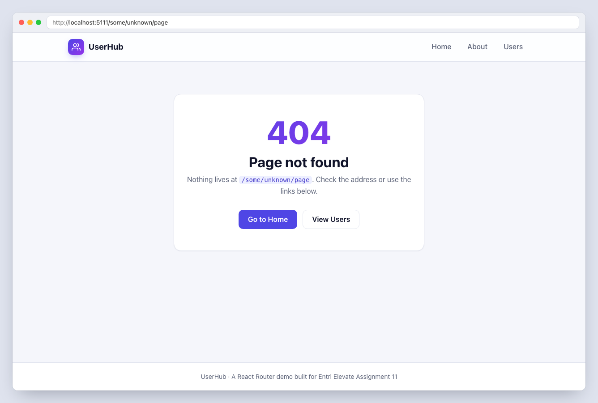

### Active route highlighting
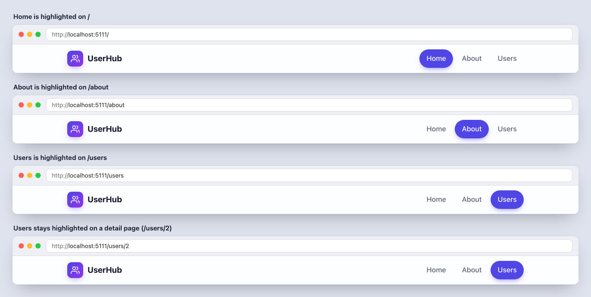

### Mobile (390px)
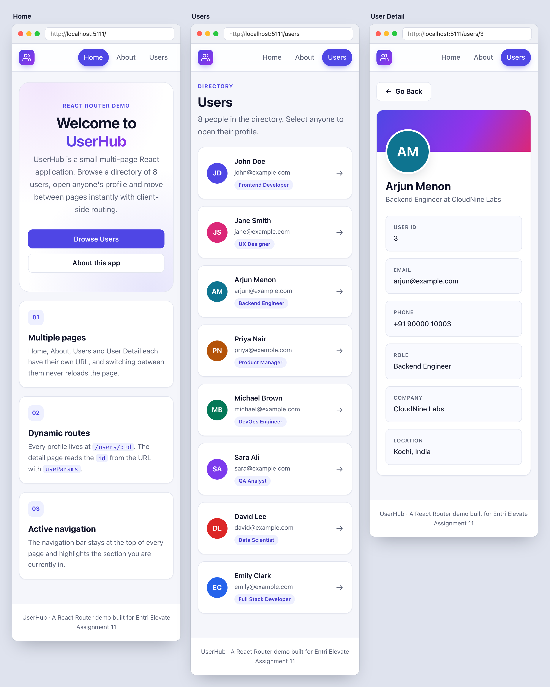

### Tablet (768px)
<p>
  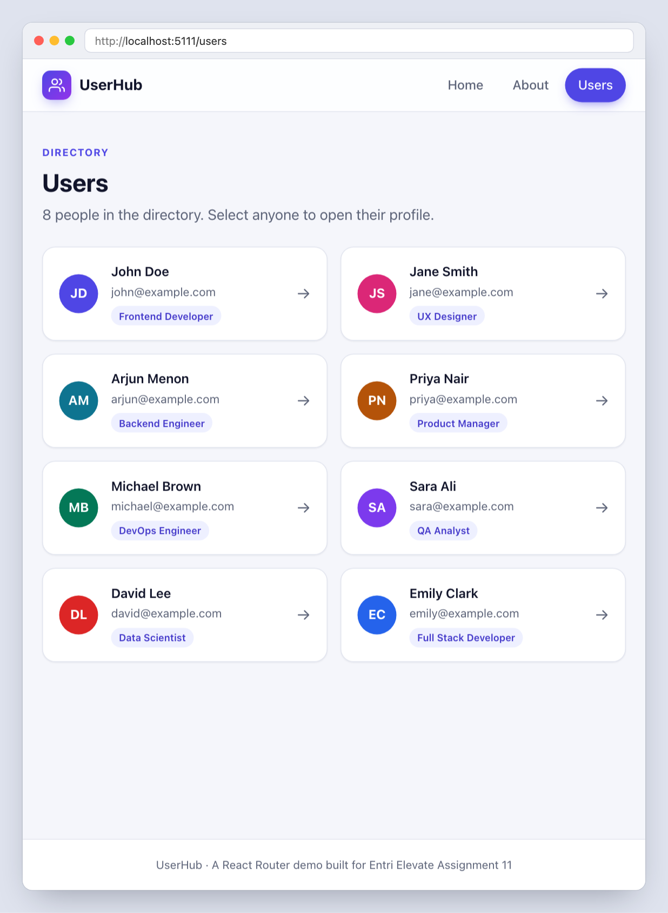
  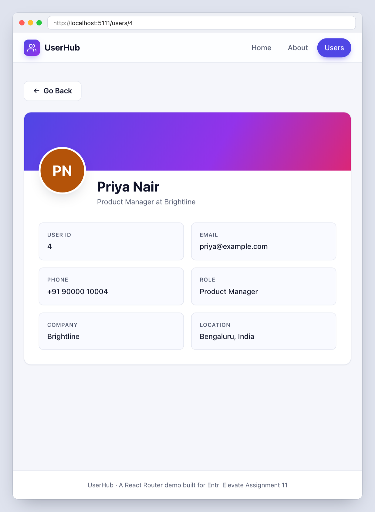
</p>

## Testing

The app was checked in a real browser (Chromium via Playwright) against both the dev server and the production
build:

- every navbar link, the Home buttons, the About *Back to Home* link and the brand logo
- active highlighting on every route, including `/users/:id`
- all 8 user links open the right detail page, and *Go Back* returns to `/users`
- opening `/users/3` directly, invalid ids (`/users/99`, `/users/abc`, `/users/0`), and unknown URLs
- browser back/forward, keyboard navigation, scroll position, and no horizontal overflow from 320px to 1440px
- no console errors or warnings

`npm run build` and `npm run lint` both finish with no errors or warnings.
